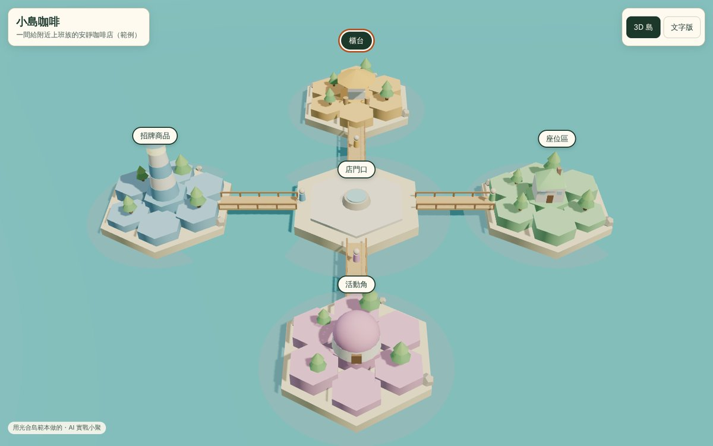

# 不會寫程式，也能用 AI 蓋一座 3D 島

**PGY AI LAB｜AI 實戰小聚 第 3 場・2026/11/12（四）19:00・光合創學（十四張捷運站旁）**

**這座島是範本改幾行字做出來的。** 小聚當晚，你也會帶走一座自己的。

## 📱 學員操作頁（現場用這個）

**[▶ 打開學員操作頁](https://kkstudio1984-design.github.io/ai-xiaoju-1112/guide.html#student)**：先選路、成果對照、每段指令都有「複製」按鈕、卡住了怎麼辦、看不懂的詞。手機也能用；從 LINE 點進來的，請先按「⋯」改用 Safari 或 Chrome 開啟。

## 🎮 先玩玩看（手機也可以）

**[▶ 打開線上試玩](https://kkstudio1984-design.github.io/ai-xiaoju-1112/)**：拖曳轉島、點島看說明、按「跟著導覽」逛一圈。不用下載、不用帳號。

玩完想一下：**如果是你的島，上面會放哪 4 座？** 想不到就看 [範例資料](範本/範例資料.md)，有個人品牌、小店、社群三種可以照抄。

## ⬇️ 一鍵下載

**[按這裡下載整包（ZIP）](https://github.com/kkstudio1984-design/ai-xiaoju-1112/archive/refs/heads/main.zip)**

下載後解壓縮就能用，不用註冊 GitHub。
（也可以按這一頁上方綠色的 **Code** → **Download ZIP**。）

## ✨ 只有現場才有

這包素材是讓你先熱身、回家複習用的。下面這些，要來才拿得到：

- **AR 闖關**：手機掃海報上的 QR Code，島上的關主跳出來跟你過招。三關各教一招提示詞心法，闖完有過關獎勵。
- **當場救援**：卡在哪一步，舉手就有人幫你看你的島、陪你改到能用。
- **20:00 神秘講者**：這一小時留給一位特別來賓，人選在社群公布。
- **互相看島**：跟同一晚的同好交換點子，你的島可能就是下一個人的靈感。

**帶筆電、先註冊好 Claude 帳號（[claude.ai](https://claude.ai)）**，現場就能直接開始。

## 裡面有什麼

| 檔案 | 內容 | 什麼時候看 |
| --- | --- | --- |
| [01-動手前先想清楚.md](01-動手前先想清楚.md) | 資料清單、第一層放什麼、隱私 | 動手之前 |
| [02-主指令.md](02-主指令.md) | 做出第一版島的完整指令，加上改版指令 | 開始做 |
| `02-主指令.txt` | 完整版指令的純文字檔，用記事本改中括號最方便 | 回家做 |
| `02-最小版主指令.txt` | 只做 4 座島＋點島說明＋文字版，生成快、比較不會出錯 | **小聚現場** |
| [03-加碼指令.md](03-加碼指令.md) | A～L 十二段加功能指令（打卡、日夜、導覽、任務⋯） | 第一版穩了之後 |
| [04-卡關救援.md](04-卡關救援.md) | 常見狀況、光合島踩過的坑、上線檢查（MVP 三招的原句現場闖關拿） | 卡住的時候 |
| [05-免費3D素材.md](05-免費3D素材.md) | 免費 3D 素材庫和授權怎麼看 | 想換模型、加角色 |
| [06-現場作品牆.md](06-現場作品牆.md) | 小聚當晚大家做出來的島 | 小聚之後 |
| `範本/小島範本.html` | 雙擊就能打開的 3D 小島（有導覽、會動的島民），改最上面幾行字就變你的島 | **小聚現場** |
| `範本/範例資料.md` | 三份照抄就能用的島：個人品牌、小店、社群 | **不知道放什麼時** |
| `範本/造島清單範本.csv` | 「島名｜在做什麼｜小區塊」三欄，用 Excel 打開填 | 整理資料 |

## 🕐 現場 15 分鐘：離開前帶走一座小島

看你手邊有什麼，選一條路：

| | A. 改範本（最快、一定成功） | B. 請 Claude 幫你蓋（比較漂亮） |
| --- | --- | --- |
| 需要 | 筆電；下載一次後就不用網路，也不用帳號 | 筆電或手機＋Claude 帳號（免費帳號也可以，次數比較少） |
| 多久看到 | 約 5 分鐘 | 填資料 5 分鐘＋生成 3～5 分鐘 |
| 成品 | 一個 HTML 檔，存在你電腦裡 | 一個網址，可以直接分享給別人 |

### A. 改範本（筆電）

1. 下載整包，到「下載」資料夾找到 `ai-xiaoju-1112` 開頭的壓縮檔，**先全部解壓縮**（Windows：按右鍵 →「全部解壓縮」；Mac：雙擊）。打開解開的資料夾（裡面還有一層同名資料夾就再點進去），找到 `範本`。不要在 ZIP 裡直接雙擊，畫面會空白。
2. 雙擊 `小島範本.html`，先看看長什麼樣子。
3. 在 `小島範本` 上按右鍵 →「開啟檔案」→「記事本」（看不到就選「選擇其他應用程式」）。
   Mac 用「文字編輯」：**先**打開文字編輯 App，到「設定 → 打開與儲存」勾選「將 HTML 檔案顯示為 HTML 程式碼」，再用它打開範本；不然會看到排版好的頁面而不是文字。
4. 按 Ctrl＋F（Mac ⌘＋F）找「改這裡」。只改兩個 `'` 中間的字，共 9 個地方：島名、介紹、2 個數字、中間廣場（center）、4 座島的名字。**不要自己打任何符號**：選取引號中間的字刪掉再打新的就好。打錯的話，範本會跳出提示告訴你大約第幾行。
5. 按 Ctrl＋S（Mac ⌘＋S）存檔，回到瀏覽器按 F5 重新整理，就是你的島了。中文變亂碼的話，看學員操作頁「卡住了」。

### B. 請 Claude 幫你蓋（筆電）

1. 打開[學員操作頁](https://kkstudio1984-design.github.io/ai-xiaoju-1112/guide.html#student)的「指令表」，複製「最小版主指令」，先貼到記事本，把每個【　】連同括號換成你的資料。
2. 開一個新的 [claude.ai](https://claude.ai) 對話，整段貼上送出。
3. 等 3～5 分鐘，按「發布」（Publish）拿到連結（按鈕名稱以畫面為準）。
4. 想改哪裡，**一句話改一個地方**。
5. 沒有 Claude、或免費次數用完：學員操作頁有「其他 AI 版」指令，可以貼到 Gemini（Canvas）或 ChatGPT（畫布）。

### B. 請 Claude 幫你蓋（只有手機）

1. 在手機上打開[學員操作頁](https://kkstudio1984-design.github.io/ai-xiaoju-1112/guide.html#student)，到「指令表」。
2. 按「最小版主指令」旁邊的「複製」（不要用長按）。
3. 打開 Claude App 或用手機瀏覽器開 claude.ai，**不要用 LINE 內建瀏覽器**。
4. 先貼到手機「備忘錄」，把每個【　】連同括號換成你的資料，再全選複製，貼到 Claude 送出。
5. 出來後按「發布」（Publish）拿到連結（按鈕名稱以畫面為準）。沒有 Claude 的人，改用學員操作頁的「其他 AI 版」貼到 Gemini 或 ChatGPT。

> 卡住了？舉手，或翻 [04-卡關救援.md](04-卡關救援.md)。

## 回家再長大

1. 照 **01** 想清楚：哪些資訊重要、放第幾層。
2. 用 **02** 的完整版主指令重做一座更漂亮的，或在原本的對話裡繼續改。
3. 穩了再從 **03** 挑一個功能加上去，一次一個。

## 範例

- 光合島（光合創學官網上的版本）：<https://sunlight-hub.com/island>

## 交作業

做出你自己的島，路線 B 貼連結、路線 A 貼截圖到小聚 LINE 群組，附一句「這座島給誰看」。

---

光合創學 × 蒲公英創意商業研究所｜光光、刀神、小助教

素材僅供小聚學員學習使用。3D 素材的授權以各素材網站為準。
